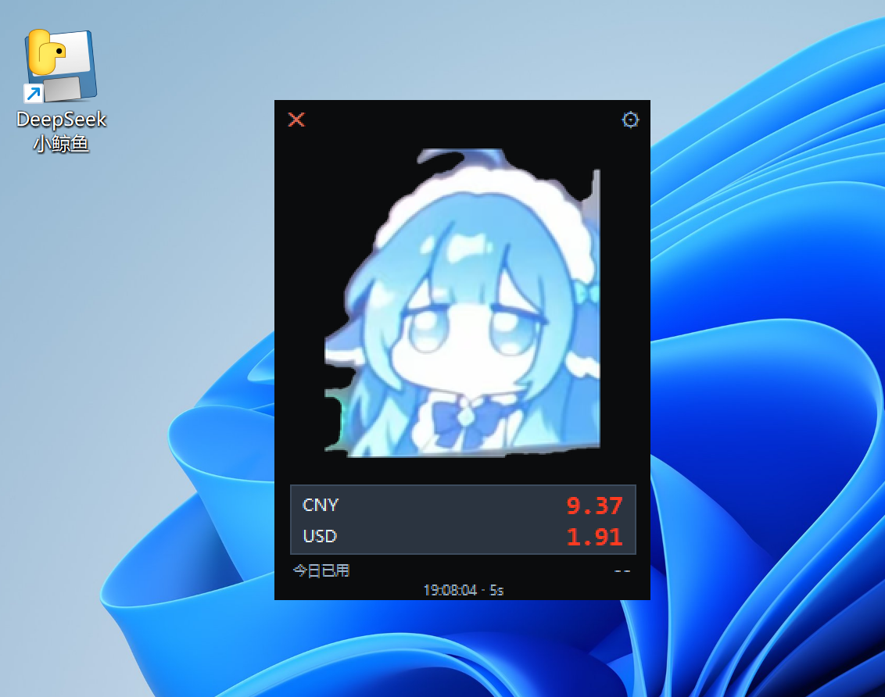

# DeepSeek 小鲸鱼额度桌宠



一个运行在 Windows 桌面上的 DeepSeek API 余额小挂件。它会以置顶、无边框的桌宠窗口显示账户余额，并按固定间隔刷新，让余额信息更容易被看到。

> **重要说明**：本仓库当前发布的是 Windows 64 位单文件可执行程序，而不是完整源代码工程。因此它属于“公开发布的二进制版本”，并不等同于完整意义上的源代码开源。若你需要参与开发，请先联系仓库维护者获取源码或贡献方式。

## 功能

| 功能 | 说明 |
| --- | --- |
| 余额展示 | 同时显示 CNY 与 USD 余额（以账户接口返回为准） |
| 自动刷新 | 默认每 5 秒刷新一次 |
| 扣费提示 | 余额发生扣减时显示扣费提示，充值时显示绿色增加提示 |
| 今日已用 | 按币种记录当天消耗情况 |
| 桌面体验 | 窗口置顶、无边框、背景透明，可拖动到任意位置 |
| 右键菜单 | 立即刷新、设置 API Key、创建快捷方式、清除数据、退出 |

## 下载与运行

请在 [Releases](../../releases) 页面下载 `DeepSeekWhalePet.exe`，将它放到一个固定文件夹后运行。首次启动可能需要等待几秒，这是单文件打包程序的正常启动过程。

启动后，点击窗口右上角的齿轮图标，或者打开右键菜单中的设置项，填入你自己的 DeepSeek API Key，然后选择“保存并刷新”。API Key 应通过 DeepSeek 官方平台自行创建；请勿在 Issue、Pull Request 或聊天中公开粘贴密钥。

程序默认将配置和账本保存在当前 Windows 用户目录下的：

```text
C:\Users\<你的用户名>\.deepseek-whale-widget\config.json
```

点击窗口右上角的“×”只会隐藏窗口，程序仍可能在后台运行。要彻底退出，请通过右键菜单选择“退出”，或在任务管理器中结束 `DeepSeekWhalePet.exe` 进程。

## 系统要求

目前仅支持 **64 位 Windows**。macOS、Linux 及 Windows 32 位系统不在当前发布版本的支持范围内。

## 网络与隐私说明

程序需要访问 DeepSeek 的余额接口才能显示数据。根据随附说明，程序使用的接口地址为：

```text
https://api.deepseek.com/user/balance
```

API Key 会以明文保存在本机配置文件中。请妥善保护该文件，并在怀疑泄露时立即在 DeepSeek 平台撤销或更换密钥。使用任何未经代码审计的第三方二进制文件都存在固有风险；建议在隔离环境中进行首次运行，并自行核验下载文件的 SHA-256 哈希。

本仓库提供的当前二进制文件哈希如下：

```text
SHA-256: c80e26faac947205833db47543fe2071375c7cf1ea2c59b0266bf38e6cb9a163
```

## 安全提示

该程序没有数字签名，Windows SmartScreen 或杀毒软件可能显示警告。请不要因为提示而直接关闭安全防护或添加系统级排除项；在运行前应先确认文件来源、核对哈希，并根据自己的安全策略决定是否使用。仓库维护者不会要求你提供 API Key，也不会在 Issue 中索要任何凭据。

如果发现疑似安全问题，请不要公开发布密钥、个人信息或可复现的敏感配置。可以先通过 GitHub 私下联系维护者，并在问题修复后再公开讨论。

## 卸载

在程序右键菜单中选择“卸载 / 清除数据”，按照提示删除配置和账本；如需删除程序文件，再手动删除下载目录中的 `DeepSeekWhalePet.exe`。

## 许可证

本仓库新增的文档与项目整理内容采用 [MIT License](LICENSE)。需要注意的是，当前仓库中的预编译程序可能包含第三方运行库或其他组件，其权利归相应权利人所有；使用者应遵守相关许可条款。

## 免责声明

本项目是个人工具，**不是 DeepSeek 官方软件**，与 DeepSeek 没有隶属、代理或背书关系。项目按“现状”提供，维护者不保证余额数据始终准确、接口持续可用或程序适用于所有环境。使用者应自行承担运行第三方软件和管理 API Key 的风险。

## 致谢

感谢所有提出建议、测试程序和反馈问题的使用者。欢迎通过 GitHub Issues 提交可复现的问题描述，但请务必删除 API Key、配置文件和其他敏感信息。
